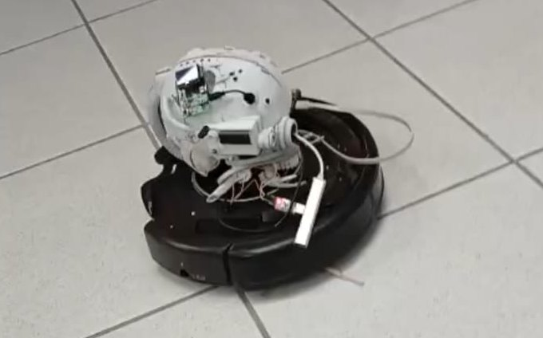

# Roomba 40K

Controle remoto, câmera e boombox para um Roomba 561 compatível com a Open
Interface do iRobot Create 2, executado em um Raspberry Pi 3B+.



O projeto combina controle web em tempo real, modo autônomo, telemetria,
stream WebRTC, música, efeitos de colisão e um interfone do navegador para o
alto-falante do Raspberry Pi.

## Funcionalidades

- Controle diferencial por D-pad, joystick ou teclado, de 50 a 500 mm/s.
- Parada automática após 300 ms sem comando e ao desconectar o WebSocket.
- Um cliente motorista por vez; os demais acompanham como espectadores.
- Modo autônomo com reação a bump, wheel drop e quatro sensores de cliff.
- Estado da bateria, bump e cliff enviado ao navegador.
- Comandos de dock, motores de limpeza, wake e músicas no piezo do Roomba.
- Reprodução de MP3 no alto-falante do Raspberry Pi com `mpg123`.
- Efeitos MP3 disparados na borda de subida dos sensores de bump.
- Interfone PCM S16_LE mono, 16 kHz, por WebSocket e ALSA.
- Câmera CSI em H.264 por hardware, servida por MediaMTX/WebRTC.
- HTTPS local com CA própria para liberar o microfone em navegadores móveis.

## Hardware alvo

- Raspberry Pi 3B+ com Raspberry Pi OS de 64 bits.
- Roomba 561 ou outro robô compatível com a OI do Create 2.
- Adaptador USB-TTL ligado à porta serial do robô, normalmente
  `/dev/ttyUSB0`.
- Câmera CSI compatível com `libcamera`.
- Alto-falante ou placa de som disponível pelo ALSA.
- Fonte estável de 5 V. Câmera, Wi-Fi e áudio aumentam o risco de subtensão.

> **Segurança física:** faça o primeiro teste com as rodas suspensas. O software
> limita cada roda a 500 mm/s e bloqueia avanço quando detecta cliff, mas não
> substitui supervisão, sensores funcionais ou o botão físico de parada.

> **Segurança de rede:** o servidor escuta em `0.0.0.0` e não possui
> autenticação. Use somente em uma rede confiável e altere `AP_PASS` antes de
> ativar o ponto de acesso.

## Arquitetura

```text
navegador
  |-- HTTPS + arquivos estáticos ------> aiohttp (web/server.py)
  |-- WebSocket /ws -------------------> web/ws_router.py
  |                                      |
  |                                      v
  |                                 SharedState + lock
  |                                      |
  |                                      v
  |                              ControlThread (~50 Hz)
  |                                      |
  |                                      v
  |                           RoombaInterface -> pycreate2 -> serial
  |
  |-- WebSocket /voice-ws ------------> LiveVoicePlayer -> aplay -> ALSA
  |
  `-- iframe HTTPS :8889/cam ----------> MediaMTX -> câmera CSI
```

A porta serial tem um único proprietário: `ControlThread`. Os handlers
assíncronos nunca acessam `pycreate2` diretamente; eles registram o estado
desejado em `SharedState`. O loop lê esse estado, consulta sensores e envia os
comandos ao robô. Essa separação evita I/O serial bloqueante dentro do event
loop do aiohttp.

O controle usa a política "último comando vence", sem fila de movimentos. O
loop roda a cada 20 ms, a bateria é atualizada a cada 2 s e os sensores usados
pelos efeitos de bump são consultados a cada 100 ms. Comandos de movimento
repetidos não são reenviados à serial.

## Instalação

No Raspberry Pi OS, instale as ferramentas usadas pelos scripts e pelo áudio:

```bash
sudo apt update
sudo apt install curl tar openssl mpg123 alsa-utils
```

Instale o [`uv`](https://docs.astral.sh/uv/) e permita que o usuário acesse a
serial:

```bash
sudo usermod -aG dialout "$USER"
```

Faça logout e login após alterar o grupo. O `run.sh` cria `.venv` e instala
`pycreate2`, `pyserial` e `aiohttp` na primeira execução.

O MediaMTX é baixado automaticamente para `vision/mediamtx_bin/`. O script
atual baixa o binário `linux_arm64`; em um sistema operacional de 32 bits é
necessário ajustar `arch` em `vision/stream_webrtc.sh` para `linux_armv7`.

## Execução

```bash
./run.sh
```

Na primeira execução, o script gera uma CA local e um certificado para o
primeiro IP detectado. Ele imprime um link HTTP temporário, por exemplo:

```text
http://192.168.1.50:8090/roomba-ca.cer
```

Abra o link no celular durante os cinco minutos de disponibilidade, instale a
CA como confiável e depois acesse:

```text
https://192.168.1.50:8080
```

A câmera fica em `https://192.168.1.50:8889/cam` e já é incorporada pela
interface principal. O navegador só autoriza o microfone quando a origem HTTPS
é confiável.

Se o IP mudar ou o script escolher a interface errada, emita novamente o
certificado antes de iniciar:

```bash
./setup_https.sh 192.168.1.50
./run.sh
```

Nunca distribua `ca.key` ou `server.key`. O servidor temporário publica somente
`roomba-ca.cer`.

Para iniciar apenas o backend, sem o script da câmera:

```bash
uv run python -m web.server
```

Sem `ROOMBA_TLS_CERT` e `ROOMBA_TLS_KEY`, esse comando usa HTTP e o interfone
pode ser bloqueado pelo navegador.

## Configuração

| Variável | Padrão | Uso |
| --- | --- | --- |
| `ROOMBA_PORT` | `/dev/ttyUSB0` | Porta serial do robô |
| `ROOMBA_HTTP_PORT` | `8080` | Porta do aiohttp |
| `ROOMBA_TLS_DIR` | `~/.config/roomba_40k/tls` | CA, certificado e chave locais |
| `ROOMBA_TLS_CERT` | gerenciado por `run.sh` | Certificado do aiohttp e MediaMTX |
| `ROOMBA_TLS_KEY` | gerenciado por `run.sh` | Chave do certificado |
| `ROOMBA_CA_PORT` | `8090` | Download temporário da CA pública |
| `MUSIC_DIR` | `~/Music` | Busca recursiva de MP3s da música |
| `MUSIC_ALSA_DEV` | `hw:1,0` | Saída ALSA do `mpg123` |
| `MUSIC_AUTOPLAY` | `0` | Use `1` para tocar ao iniciar |
| `VOICE_ALSA_DEV` | `MUSIC_ALSA_DEV` como `plughw` | Saída ALSA do interfone |
| `HORN_ALSA_DEV` | `MUSIC_ALSA_DEV` como `plughw` | Saída ALSA da buzina (botão 📯 ou tecla H) |
| `ROOMBA_MAX_VOLUME` | `1` | `run.sh` deixa o volume do cartão de `MUSIC_ALSA_DEV` no máximo; use `0` para desligar |
| `BUMP_AUDIO_DIR` | `~/roomba_sounds` | MP3s tocados após colisão |
| `BUMP_AUDIO_ALSA_DEV` | `hw:1,0` | Saída ALSA dos efeitos |
| `AP_SSID` | `Roomba40k` | Nome do ponto de acesso |
| `AP_PASS` | `roomba123` | Senha do ponto de acesso; altere-a |
| `AP_IFACE` | `wlan0` | Interface Wi-Fi usada pelo AP |

Exemplo:

```bash
ROOMBA_PORT=/dev/ttyACM0 \
MUSIC_DIR="$HOME/Music/roomba" \
MUSIC_ALSA_DEV=hw:2,0 \
VOICE_ALSA_DEV=plughw:2,0 \
./run.sh
```

Use `aplay -l` para listar dispositivos ALSA (no jack P2 de 3,5 mm do Pi 3B+
é tipicamente `hw:0,0`, a placa "Headphones"). A buzina (botão 📯 ou tecla H,
só para o motorista) é sintetizada em memória e tocada por um `aplay`. Música, efeitos e interfone
compartilham o alto-falante: ao abrir o interfone, os outros players são
suspensos para liberar o dispositivo.

## Ponto de acesso

O script requer NetworkManager e privilégios de root:

```bash
sudo AP_PASS='troque-esta-senha' ./ap_mode.sh on
sudo ./ap_mode.sh status
sudo ./ap_mode.sh off
```

O gateway padrão é `10.42.0.1`. Gere o certificado especificamente para esse IP
antes de usar HTTPS no AP:

```bash
./setup_https.sh 10.42.0.1
./run.sh
```

Depois, abra `https://10.42.0.1:8080`. As mensagens HTTP ainda impressas por
`ap_mode.sh` são históricas; o fluxo recomendado usa HTTPS.

## Câmera

O pipeline principal está em `vision/stream_webrtc.sh`:

```text
câmera CSI -> source rpiCamera -> H.264 por hardware -> MediaMTX -> WebRTC
```

O perfil atual em `vision/mediamtx.yml` usa 160x120, 8 fps, 200 kbit/s,
keyframe a cada oito quadros e fila de escrita 64. Ele prioriza estabilidade e
baixa latência no Pi 3B+.

Pipelines auxiliares:

- `vision/stream_csi.sh`: servidor MJPEG com Picamera2, não incorporado ao app.
- `vision/stream_cam.sh`: webcam USB com ustreamer para testes de posição.
- `vision/old_code/`: streamer Python aposentado; não é o caminho de produção.
- [`vision/STREAMING_NOTES.md`](vision/STREAMING_NOTES.md): histórico de testes
  e diagnóstico de streaming.

O `run.sh` encerra o outro processo se o backend ou o MediaMTX terminar. Uma
falha de câmera, download ou arquitetura do binário também encerra o controle
iniciado pelo script.

## Áudio

O projeto possui três saídas independentes:

| Recurso | Saída | Implementação |
| --- | --- | --- |
| Música e efeitos | Alto-falante do Pi | `mpg123` em `media/` |
| Interfone | Alto-falante do Pi | PCM 16 kHz em `aplay` |
| Músicas OI | Piezo interno do Roomba | opcodes 140 e 141 |

O interfone aceita apenas uma sessão. O navegador envia blocos PCM recentes e
descarta backlog excessivo; o servidor aplica backpressure ao stdin do `aplay`.
O buffer ALSA configurado é 80 ms, com período de 20 ms.

## Open Interface do iRobot

A referência oficial incluída no repositório é o
[`iRobot Create 2 Open Interface Specification`](docs/irobot-create2-open-interface-spec.pdf),
atualizado em 2 de abril de 2015 e baseado no Roomba 600.

| Função usada | Comando ou pacote OI | Manual | Código |
| --- | --- | --- | --- |
| Abrir OI | Start, opcode 128 | p. 7 | `roomba/interface.py` |
| Modo protegido | Safe, opcode 131 | p. 6 e 9 | `roomba/interface.py` |
| Rodas independentes | Drive Direct, opcode 145, -500..500 mm/s | p. 13 | `roomba/interface.py`, `roomba/drive.py` |
| Procurar base | Seek Dock, opcode 143 | p. 10 | `roomba/interface.py` |
| Escovas e aspirador | Motors, opcode 138 | p. 14 | `roomba/interface.py` |
| Definir e tocar música | Song 140 e Play 141 | p. 18-19 | `roomba/songbook.py`, `roomba/interface.py` |
| Consultar sensores | Sensors, opcode 142 | p. 20 | `roomba/interface.py` |
| Bump e wheel drop | Pacote 7 | p. 22 | `roomba/bump_watch.py`, `roomba/auto.py` |
| Quatro cliffs digitais | Pacotes 9-12 | p. 22-23 | `roomba/auto.py`, `web/control_thread.py` |
| Estado e medidas da bateria | Pacotes 21-26 | p. 26-27 | `roomba/battery.py` |
| Detectar Passive/Safe | OI Mode, pacote 35 | p. 28 | `web/control_thread.py` |
| Evitar sono em Passive | Pino BRC | p. 3 e 6 | `roomba/interface.py` |

O projeto opera em Safe, não em Full. Conforme o manual, cliff, wheel drop ou
conexão ao carregador podem parar os motores e reverter a OI para Passive. O
controle observa o pacote 35 e refaz `Start` seguido de `Safe` antes do próximo
movimento.

O PDF local não cita o Roomba 561 nominalmente. Ele documenta a Create 2 OI
baseada na série 600; portanto, compatibilidade elétrica, wake por BRC e todos
os comandos devem ser validados no hardware usado. A serial, a ordem de bytes
de Drive Direct e parte da decodificação dos sensores são delegadas ao pacote
`pycreate2`, atualmente sem versão fixada em `requirements.txt`.

## Estrutura do repositório

| Caminho | Responsabilidade |
| --- | --- |
| `roomba/` | Wrapper da OI, direção, bateria, sensores, auto e songbook |
| `web/` | aiohttp, WebSockets, estado compartilhado e thread de controle |
| `web/static/` | Interface web em HTML, CSS e JavaScript |
| `media/` | Música, efeitos de bump e interfone ALSA |
| `vision/` | MediaMTX/WebRTC e alternativas de câmera |
| `cli/`, `main.py` | Controle local pelo terminal |
| `tests/` | Testes unitários e de integração sem hardware real |
| `docs/` | Foto e especificação oficial da iRobot |
| `archive/` | Experimentos que não fazem parte do fluxo atual |

## Testes e qualidade

Instale as dependências de desenvolvimento e execute a suíte:

```bash
uv pip install pytest
uv run python -m pytest tests -q
```

O analisador agregado possui dependências próprias:

```bash
uv pip install -r quick_python_analisys/require.txt
./quality.sh
```

Os testes usam fakes para serial, sensores e subprocessos. Ainda são necessários
testes físicos no Raspberry Pi para porta serial, BRC/wake, ALSA, câmera,
certificado no celular e comportamento sob Wi-Fi instável.

## Diagnóstico rápido

- Serial negada: confirme `ls -l /dev/ttyUSB0` e o grupo `dialout`.
- Robô não se move após dock: o próximo drive deve restaurar Safe; confira os
  logs e a ligação serial se isso não ocorrer.
- Microfone bloqueado: confirme HTTPS, SAN com o IP atual e CA confiável no
  celular.
- Áudio ausente ou ocupado: confira `aplay -l`, `MUSIC_ALSA_DEV` e
  `VOICE_ALSA_DEV`.
- MediaMTX não inicia: confirme sistema arm64, acesso ao GitHub e câmera CSI no
  `libcamera`.
- Pi reinicia ou congela com câmera: execute `vcgencmd get_throttled`; valor
  diferente de `0x0` pode indicar subtensão passada ou atual.
- WebRTC não conecta: confira se o IP anunciado por `stream_webrtc.sh` pertence
  à mesma rede do cliente e se UDP não está bloqueado.

## Documentação complementar

- [`web/README.md`](web/README.md): detalhes históricos do controle web.
- [`vision/STREAMING_NOTES.md`](vision/STREAMING_NOTES.md): experimentos de
  câmera, latência e energia.
- [`docs/irobot-create2-open-interface-spec.pdf`](docs/irobot-create2-open-interface-spec.pdf):
  especificação oficial da Open Interface.
